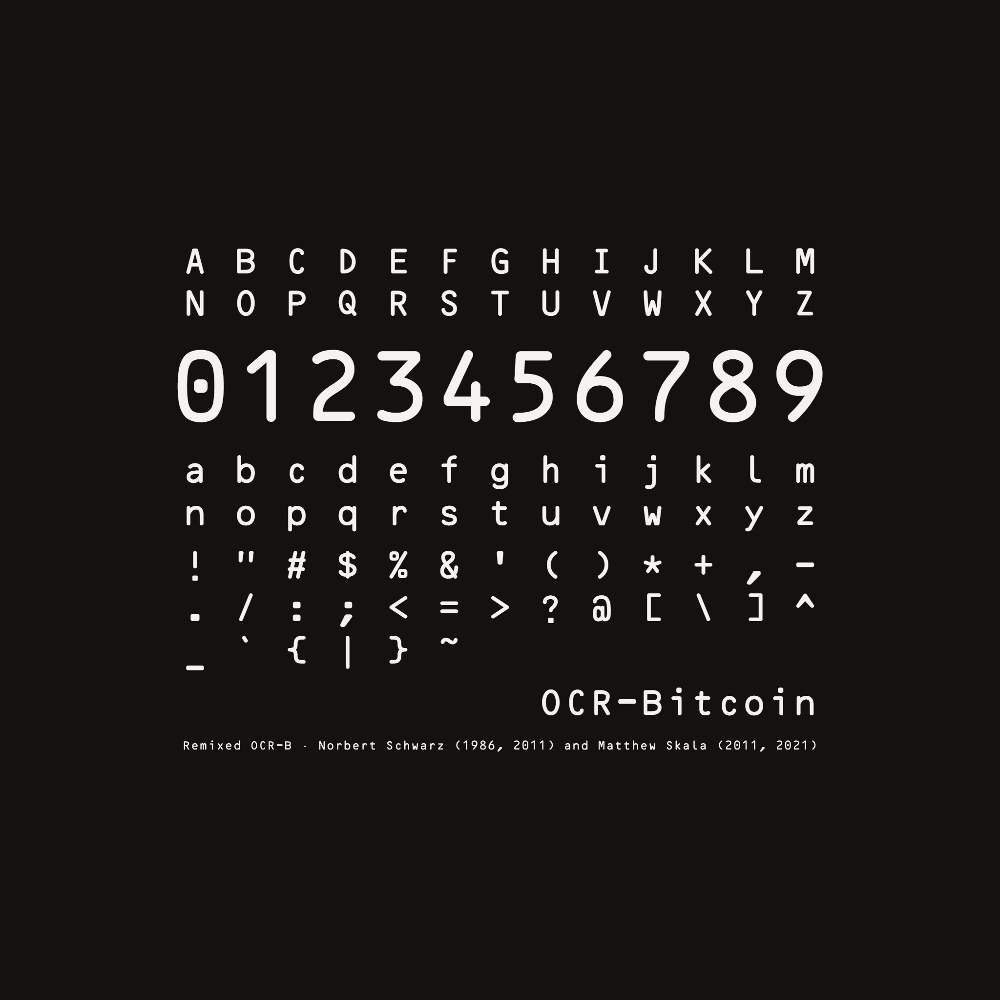
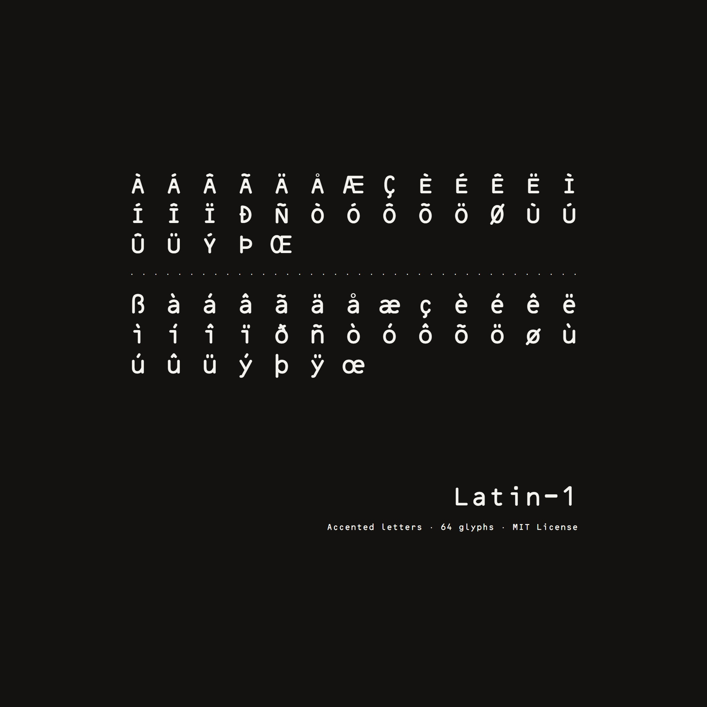
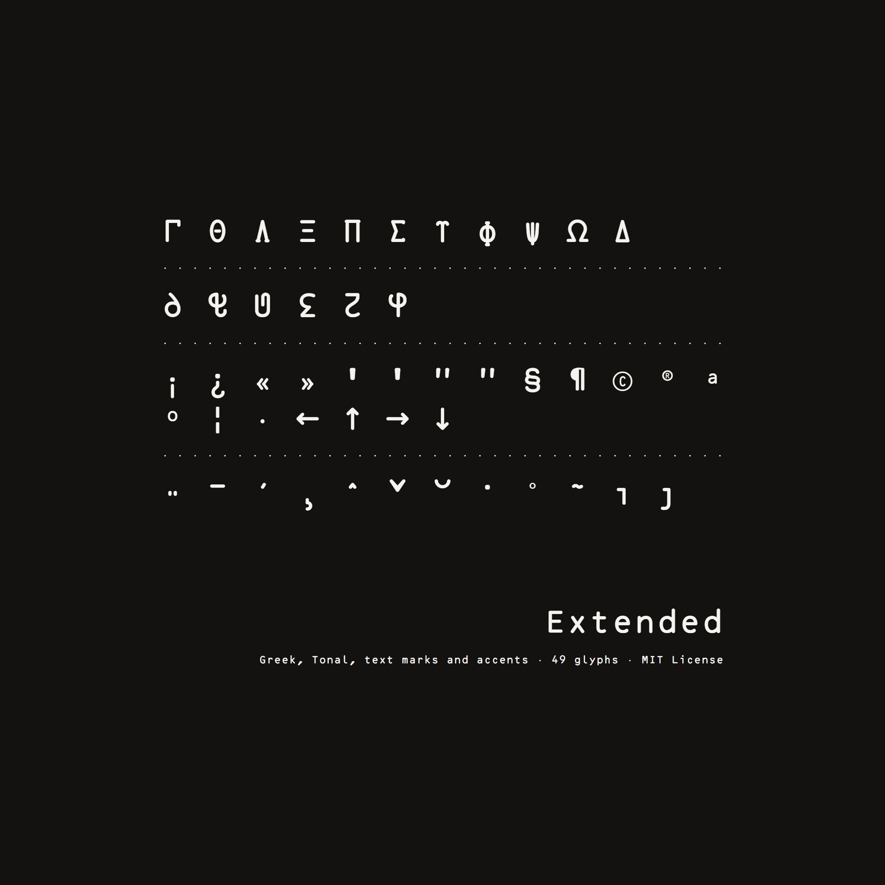
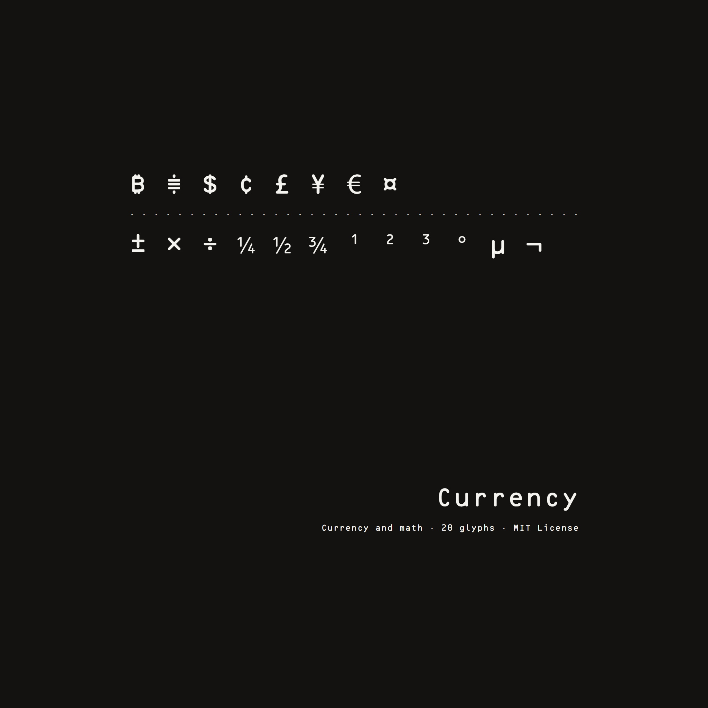
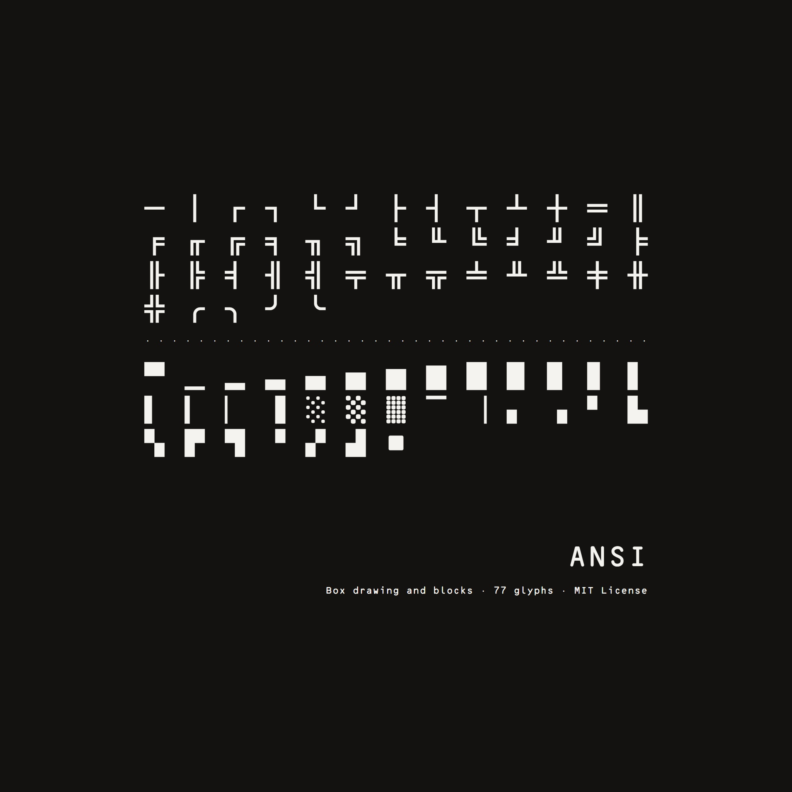
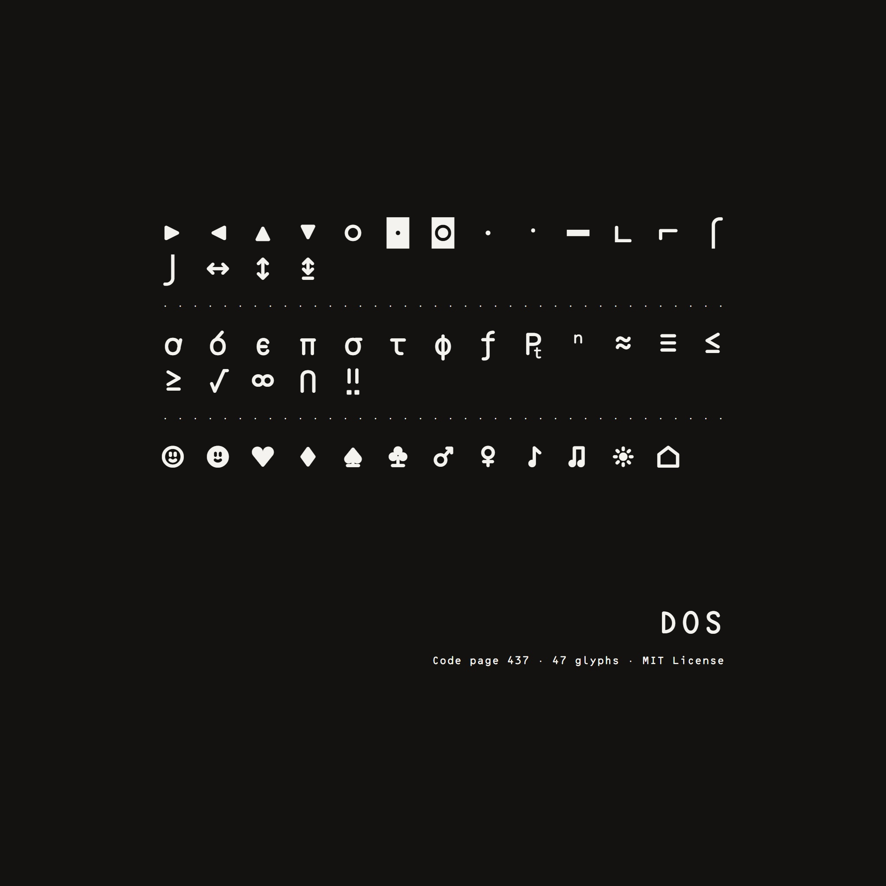
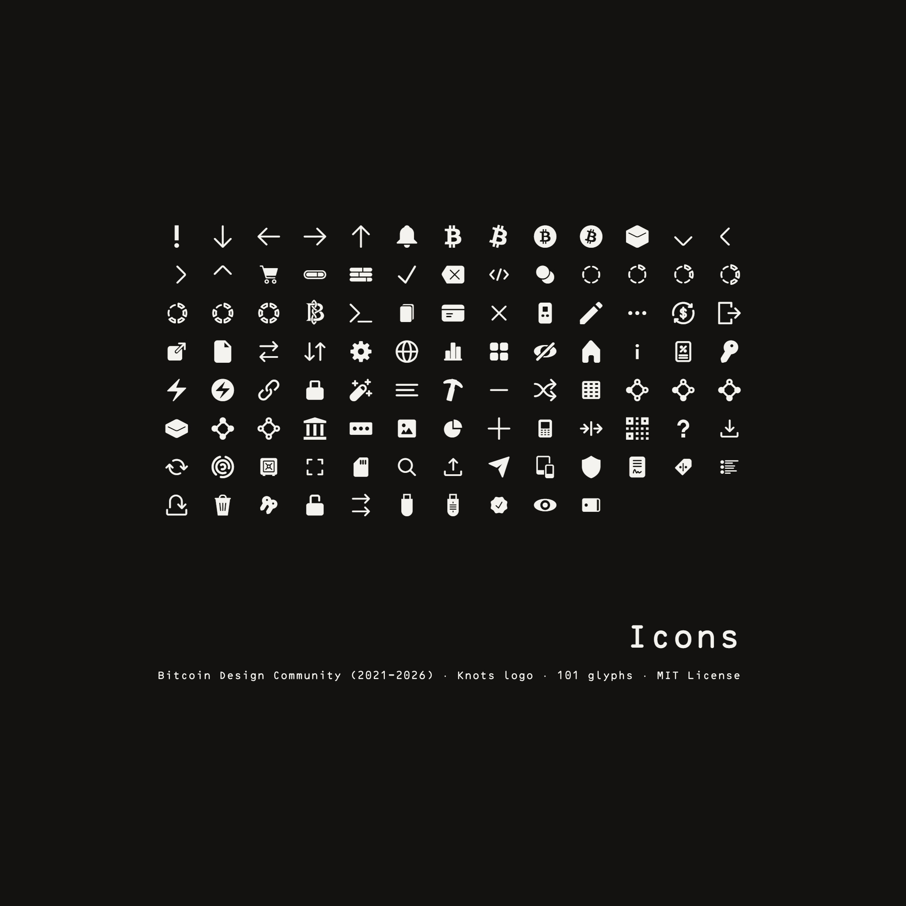
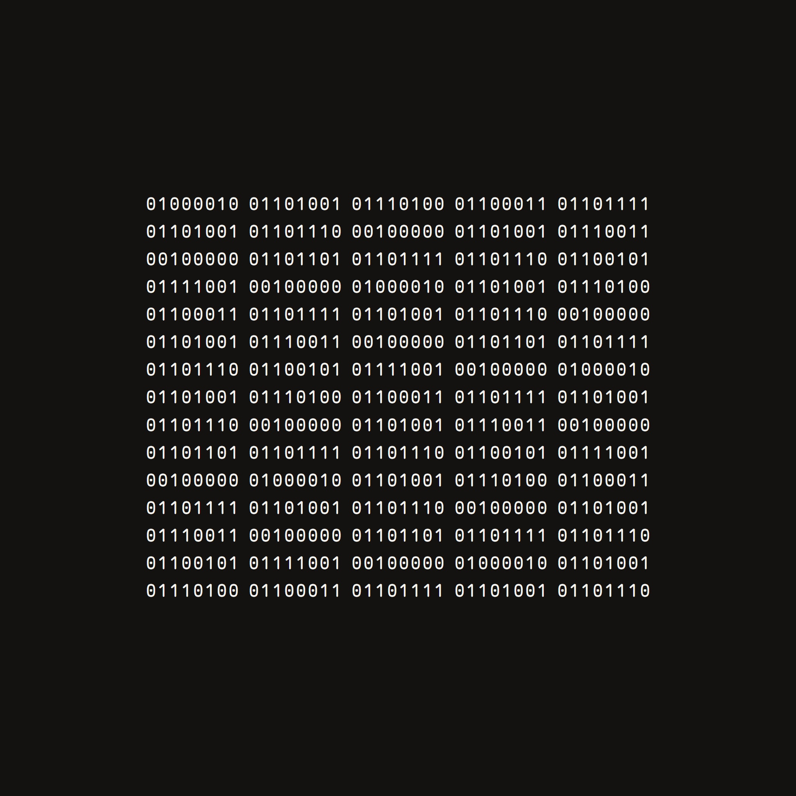

# OCR-Bitcoin

Version 2.0. MIT License.

OCR-Bitcoin is a monospace typeface made for Bitcoin and readouts and released under the MIT License for anyone to use.

Its letters are traced in Illustrator from OCR-B by Norbert Schwarz (1986, 2011) and Matthew Skala (2011, 2021), both released free by their authors.

It adds box drawing, block elements, Tonal numerals and the Bitcoin Icons by the Bitcoin Design community (2021-2026, MIT License).

## Files

The font files are in the `fonts` folder.

| File | Use |
|---|---|
| OCR-Bitcoin.otf | Desktop. OpenType with PostScript outlines. |
| OCR-Bitcoin.ttf | Desktop. TrueType outlines. |
| OCR-Bitcoin.woff2 | Web. |

Install one of the desktop files, not both.

## What is in it

- 464 glyphs, 484 character codes. Every character is 723 units wide on a 1000-unit em.
- Basic Latin and Latin-1 Supplement, complete.
- Code page 437, complete: box drawing, block elements, shapes, Greek, math signs and the DOS pictograms.
- The Bitcoin sign ₿ (U+20BF), the sat sign (U+E0BF) and the Bitcoin Knots logo (U+E0C0). The knot emoji (U+1FAA2) also shows the Knots logo.
- The 100 Bitcoin Icons, in the Private Use Area from U+E801 to U+E878.
- Tonal numerals, U+E8E0 to U+E8EF, with a second copy at U+E9D0 to U+E9DF.

## Specimen

## Checking a download

`fonts/SHA256SUMS.txt` lists the SHA-256 of each font file. To check a file, open a terminal in the `fonts` folder and run:

Windows: `certutil -hashfile OCR-Bitcoin.otf SHA256`

Mac or Linux: `shasum -a 256 OCR-Bitcoin.otf`

The result must match the line for that file in SHA256SUMS.txt.

## License

MIT. The full text and the copyright lines are in LICENSE and inside each font file.
